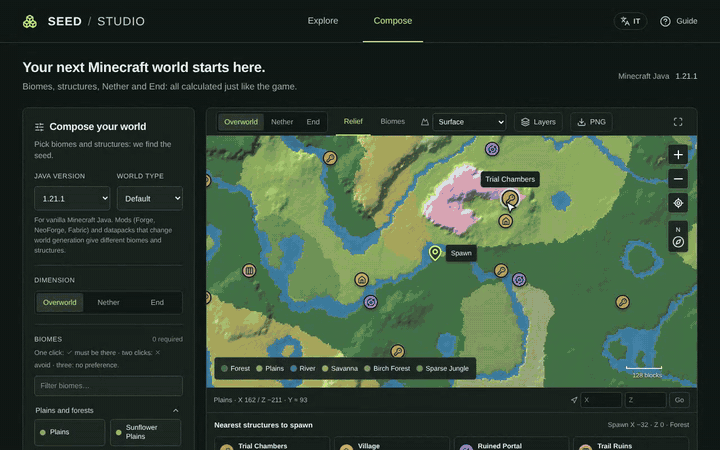

<div align="center">

# 🌱 SEED STUDIO

### Build the Minecraft world you actually want to play.

**Explore, compose and discover Minecraft Java Edition seeds through an interactive map, structure filters and a real first-person world preview.**

[](#)
[](https://www.typescriptlang.org/)
[](https://webassembly.org/)
[](https://github.com/kradeee/Seed-Studio-Private-main/actions)

</div>

---


## What is Seed Studio?

Most Minecraft seed tools start with a number and tell you what is inside it.

**Seed Studio works the other way around.**

You describe the world you want, choose biomes, structures, dimensions and generation preferences, then explore seeds that match those constraints.

It combines a fast browser-based world engine with an interactive map and an optional local Minecraft preview service, so a seed can go from **search result → map → actual first-person world** without leaving the project.

### 🎬 See it in action



**▶ Try it live:** [English](https://kradeee.github.io/Seed-Studio-Private-main/en/) · [Italiano](https://kradeee.github.io/Seed-Studio-Private-main/)

## ✨ Highlights

<table>
<tr>
<td width="50%" valign="top">

### 🗺️ Interactive world map

- Pan, zoom and pinch navigation
- Overworld, Nether and End
- Biome visualization at multiple heights
- Chunk grid and slime chunks
- Visible biome legend
- Shareable map URLs

</td>
<td width="50%" valign="top">

### 🔎 Seed search

- Required and excluded biomes
- Up to 8 structure constraints
- Spawn-island searches
- Nether and End criteria
- Large Biomes support
- Parallel seed evaluation

</td>
</tr>
<tr>
<td width="50%" valign="top">

### 🏰 Structure explorer

Villages, ancient cities, trial chambers, strongholds, fortresses, bastions, monuments, woodland mansions, ruined portals, End cities and many more.

Structure details can include variants, portal eyes, End ships, blaze spawners and ready-to-copy `/tp` commands.

</td>
<td width="50%" valign="top">

### 👁️ First-person preview

Generate a real Minecraft Java world locally and inspect the area around spawn directly from Seed Studio using the optional preview service and Prismarine Viewer.

Currently supported by the preview service:

- Java 1.21.1
- Java 1.21.4

</td>
</tr>
</table>

## 🧠 How it works

Seed Studio uses **Cubiomes / Seeder logic compiled to WebAssembly** for fast seed and biome calculations directly in the browser.

```text
Your world criteria
        ↓
Seed search engine
        ↓
Cubiomes / WebAssembly
        ↓
Interactive world map
        ↓
Optional real Minecraft preview
```

The browser map does not need a remote Minecraft server for normal exploration. The optional first-person preview is separate and runs locally because generating an actual Minecraft world is, unsurprisingly, slightly heavier than drawing some colored squares on a map.

## 🚀 Quick start

### Requirements

- Node.js 22+
- npm

Clone the repository and install the dependencies:

```bash
git clone https://github.com/kradeee/Seed-Studio-Private-main.git
cd Seed-Studio-Private-main
npm install
npm run dev
```

Then open the local address printed by the development server.

Then open http://localhost:5173 (Italian) or http://localhost:5173/en/ (English).

### Production build

```bash
npm run build     # type-check + static build in dist/
npm run preview   # serve dist/ locally
```

The output is a **fully static site**: the seed engine runs in the visitor's browser (WebAssembly + Web Workers), so there is no server, database or account system. All paths are relative, so `dist/` works at a domain root or under a sub-path.

## 🌍 Publishing on GitHub Pages

`.github/workflows/pages.yml` tests, lints, builds and publishes the site at every push to `main`.

1. On GitHub: **Settings → Pages → Build and deployment → Source: GitHub Actions** (one time only).
2. Push to `main`. The site goes live at `https://kradeee.github.io/Seed-Studio-Private-main/`.
3. If you use a custom domain, set it in **Settings → Pages** and update `url` in [`site.config.ts`](site.config.ts): canonical links, hreflang, the sitemap and the social image all read it.

> A public Pages site needs a public repository on the free GitHub plan.

## 💶 Monetisation and site settings

Everything lives in [`site.config.ts`](site.config.ts). Empty values switch a feature off.

| Setting | What it does |
|---|---|
| `url` | Public address (canonical, hreflang, sitemap, Open Graph). |
| `supportUrl` | Ko-fi / Buy Me a Coffee / PayPal.me link: shows a **Support Seed Studio** link in the footer. |
| `adsenseClient` + `adsenseSlot` | Shows one responsive Google AdSense unit under the map and adds the advertising section to the privacy page. Until both are set, no ad script is loaded. |
| `contactEmail` | Contact shown on the privacy page. |

Before turning ads on:

- AdSense must approve the site; a custom domain (≈ €10/year) is usually needed, because shared `github.io` addresses are hard to get approved.
- In the EU/EEA/UK, enable Google's certified consent message (**AdSense → Privacy & messaging → GDPR**). The site does not add its own cookie banner because, without ads, it sets no cookies at all.
- Add an `ads.txt` file in `public/` with the line AdSense gives you.

## 🌐 Languages and SEO

- Italian at `/`, English at `/en/`, with the language switch in the header (the seed and map position are kept). UI strings live next to the code as `tr('italiano', 'English')`; biome names are in `components/studio/biome-names*.json`.
- Each language page has its own title, description, canonical URL, `hreflang` alternates, Open Graph / Twitter card (`public/og-image.jpg`) and JSON-LD. The build writes `sitemap.xml` and `robots.txt`.

## 👁️ First-person Minecraft preview

The first-person preview is optional and lives in [`preview-service/`](preview-service/).

It requires **Java 21** and runs alongside the web app. Because it talks to a service on your own computer, the panel only appears when the site itself runs on `localhost` (`npm run dev` or `npm run preview`); visitors of the public site do not see it.

For the complete setup, EULA step and troubleshooting guide, read:

### → [PRIMO_AVVIO_PREVIEW.md](PRIMO_AVVIO_PREVIEW.md)

The preview service downloads the official Minecraft server JAR when required, generates a temporary world for the selected seed and exposes the spawn area to the embedded viewer.

Generated worlds, downloaded JARs and local service data are intentionally excluded from Git.

## 🧱 Main project structure

```text
Seed-Studio-Private-main/
├── index.html, en/index.html  # Italian and English entry pages (SEO meta)
├── privacy.html               # Privacy page (both languages)
├── site.config.ts             # Public URL, tips link, AdSense, contact
├── src/main.tsx               # React entry
├── components/studio/         # Seed Studio UI
│   ├── Studio.tsx             # Page, search, saved seeds
│   ├── Composer.tsx           # Search criteria and results
│   ├── WorldMap.tsx           # Interactive map, PNG export
│   ├── MinecraftPreview.tsx   # First-person preview (local only)
│   ├── i18n.ts                # Language, translations, paths
│   └── favorites.ts, AdSlot.tsx
├── public/engine/             # WebAssembly seed / biome engine
├── preview-service/           # Local real-world Minecraft preview
├── engine/                    # Engine build and version tooling
├── tests/                     # Engine verification tests
└── .github/workflows/         # Tests, Pages deploy, engine rebuild
```

## ⚙️ Engine verification

Run the engine tests with:

```bash
npm run test:engine
```

The test suite checks known in-game positions and verifies structure calculations across multiple seeds and Minecraft versions.

GitHub Actions runs the engine tests automatically on pushes.

## 🔄 Updating the Minecraft engine

The WebAssembly engine can be rebuilt from Cubiomes.

On GitHub:

```text
Actions → Rebuild engine → Run workflow
```

The workflow downloads Cubiomes, compiles the engine with Emscripten, runs the verification suite and can prepare an update when upstream generation logic changes.

The exact Cubiomes revision used by the current engine is recorded in:

[`public/engine/ENGINE_VERSION.txt`](public/engine/ENGINE_VERSION.txt)

## 🧪 Verification data

Seed Studio includes known positions that can be checked directly in Minecraft using `/locate` and related commands.

See:

- [`VERIFICA.md`](VERIFICA.md) — in-game verification data
- [`PREVIEW_VERIFICA.md`](PREVIEW_VERIFICA.md) — preview checks
- [`README_SEED_STUDIO.md`](README_SEED_STUDIO.md) — extended technical notes

## 🛠️ Tech stack

- **TypeScript**
- **React**
- **Vite**
- **WebAssembly**
- **Cubiomes / Seeder**
- **Prismarine Viewer**
- **Node.js**
- **GitHub Actions**

## 🧭 Project direction

Seed Studio is being developed toward a simple goal:

> **Don't hunt through random Minecraft seeds. Describe your ideal world and find it.**

Done: static deploy, Italian/English, saved seeds, PNG map export, SEO and optional ads/tips. Next areas of work include improving the seed composer, richer result ranking, more visual world previews, better mobile interaction and expanding the real-world preview experience.

---

<div align="center">

### 🌱 Seed Studio

**Compose. Search. Explore. Spawn.**

Made for Minecraft players who have spent far too long typing random numbers into world creation screens.

<sub>Minecraft is a trademark of Microsoft / Mojang Studios. Seed Studio is an independent project and is not affiliated with or endorsed by Mojang Studios or Microsoft.</sub>

</div>
